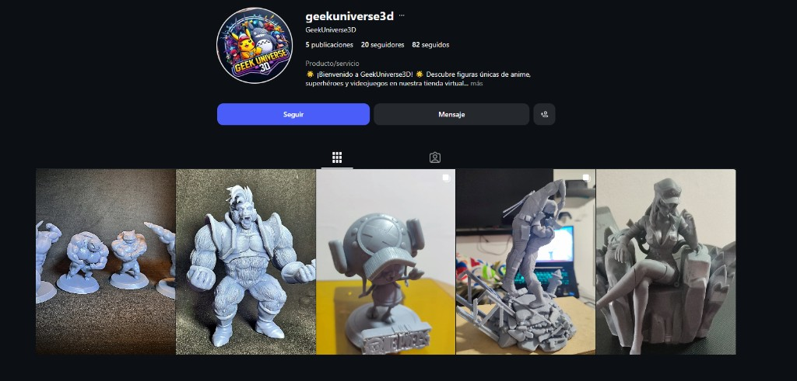
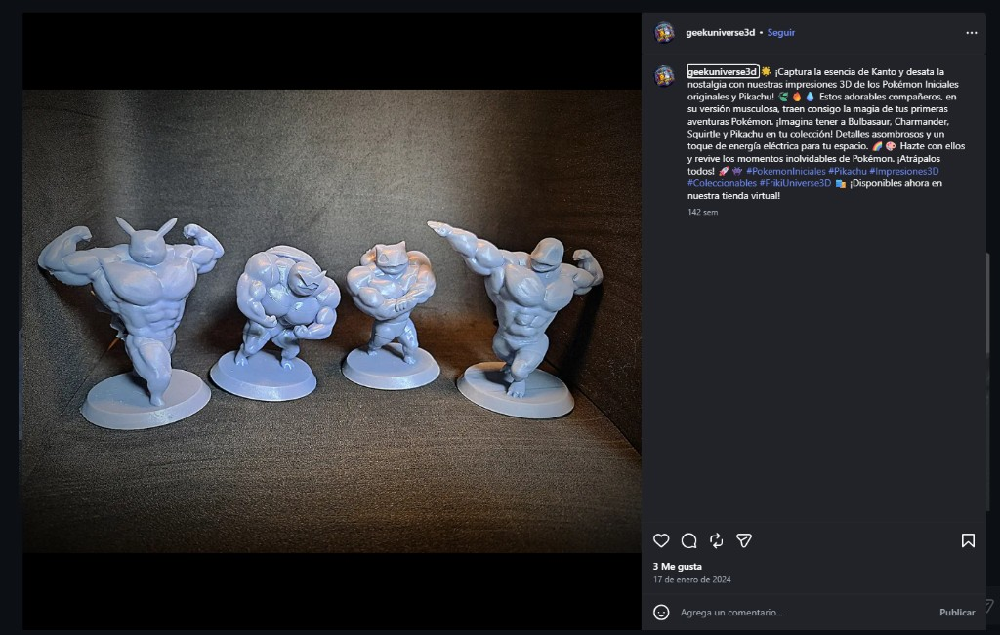

# PORTADA

*(En el PDF, la portada va en página independiente sin numerar.)*

**Institución:** Institución Universitaria Agustiniana (Uni Agustiniana)  
**Asignatura:** Comercio electrónico (E-commerce) — Unidades 1 y 2  
**Título:** Propuesta de comercialización de un producto por medio de una red social  
**Estudiante:** Alonso Esteban Amaya Gil  
**Docente:** José Vicente Barreto Hernández  
**Fecha:** 11 de octubre de 2026

---

# Introducción

La comercialización por plataformas digitales permite a organizaciones y emprendimientos ampliar cobertura, reducir costos de intermediación y dialogar directamente con clientes (Kotler y Keller, 2016). En este contexto, las redes sociales dejaron de ser espacios únicamente informativos y pasaron a funcionar como canales de *social commerce*, en los que el contenido visual, las demostraciones del proceso productivo y la interacción con la audiencia influyen en la decisión de compra (Statista, 2024).

El presente documento presenta una **propuesta de e-commerce** para comercializar productos y servicios de **impresión 3D** mediante **Instagram**, bajo el emprendimiento **Geek Universe 3D** (usuario `@geekuniverse3d`), perfil ya activo y orientado a piezas impresas, cultura geek y personalización. Instagram concentra públicos interesados en tecnología, diseño, gaming, modelismo y personalización, y ofrece herramientas para negocios (cuenta profesional, estadísticas, mensajes directos y contenido en video mediante Reels) (Instagram, 2024).

El objetivo es describir la selección del canal, la configuración del perfil, la imagen de marca del emprendimiento y la presentación de un producto o servicio real de impresión 3D, relacionando estos elementos con los conceptos de las unidades 1 y 2: comercio electrónico, marketing digital y estrategia de canales en entornos digitales.

---

# Desarrollo de la actividad

## 1. Selección de la red social

### 1.1 Análisis comparativo

| Criterio | Instagram | Facebook | TikTok |
|----------|-----------|----------|--------|
| Visualización del producto impreso | Alto (fotos, carruseles, Reels del proceso) | Medio (grupos y marketplace) | Alto (videos cortos “timelapse” de impresión) |
| Público 15–40 años (hobbies, estudio, regalos) | Muy presente | Amplio, menor foco en nicho maker | Creciente en contenido DIY |
| Pedidos y cotizaciones | MD, enlace en bio (WhatsApp) | Messenger, Marketplace | MD y enlaces |
| Costo inicial | Bajo (contenido orgánico) | Bajo | Bajo |

**Decisión:** Se mantiene **Instagram** como canal principal porque los productos de impresión 3D se comercializan mejor cuando el cliente **ve la pieza terminada**, el material (PLA, PETG, etc.) y, en muchos casos, **el proceso en la impresora**, lo cual genera confianza en dimensiones y acabado. Además, el perfil del emprendimiento ya existe en esta red, lo que reduce tiempo de implementación y permite documentar una propuesta auténtica (Laudon y Traver, 2021).

### 1.2 Público objetivo (buyer persona)

- **Nombre ficticio:** Camila, 24 años, fan de anime y videojuegos.
- **Motivación:** Coleccionar figuras de personajes icónicos (Pokémon, One Piece, superhéroes) con diseños diferenciados, sin depender de importaciones costosas.
- **Comportamiento digital:** Sigue cuentas de impresión 3D y coleccionables en Instagram; compra tras ver fotos de detalle y reseñas en comentarios o MD.
- **Objeción principal:** Calidad del acabado y fidelidad del modelo → se responde con fotografías de producto en alta definición, descripción del material impreso y atención por mensaje directo.

## 2. Creación del perfil en la red social

### 2.1 Configuración

El perfil de impresión 3D del emprendimiento **ya fue creado previamente** en Instagram. Para alinearlo con fines comerciales y académicos, se verificaron o recomiendan los siguientes elementos:

1. **Cuenta profesional** con categoría **Producto/servicio** (configuración verificada en captura de pantalla).
2. **Nombre comercial:** GeekUniverse3D; usuario **@geekuniverse3d** (5 publicaciones, 20 seguidores, 82 seguidos al momento de la evidencia).
3. Botones de interacción visibles: **Seguir** y **Mensaje**, habilitando contacto comercial directo.
4. Bio orientada a **tienda virtual** de figuras de anime, superhéroes y videojuegos, con llamado a descubrir el catálogo.

**URL del perfil:**  
https://www.instagram.com/geekuniverse3d/

*(Insertar captura: Figura 1. Perfil de Instagram de Geek Universe 3D.)*  

*Figura 1. Perfil de Instagram de Geek Universe 3D (@geekuniverse3d). Fuente: elaboración propia.*

### 2.2 Justificación de la decisión

Reutilizar un perfil existente con contenido de impresión 3D evidencia continuidad de marca y coherencia entre lo publicado y lo descrito en la propuesta. La cuenta profesional permite consultar alcance e interacciones por publicación, datos útiles para evaluar qué diseños generan más consultas (Instagram, 2024).

## 3. Elaboración de la imagen de la empresa en la red social

La identidad en red social debe comunicar **personalización, calidad de impresión y canal claro de pedidos** (Kotler y Keller, 2016).

### 3.1 Elementos de marca aplicados

| Elemento | Aplicación en Instagram |
|----------|-------------------------|
| Nombre comercial | Geek Universe 3D |
| Enfoque del negocio | Figuras 3D de anime, superhéroes y videojuegos; coleccionables y piezas de nicho geek |
| Foto de perfil | Logo circular “Geek Universe 3D” con personajes reconocibles de cultura pop |
| Estética del feed | Grid con figuras impresas (Pokémon, One Piece, escenas de acción) sobre fondos neutros |
| Paleta sugerida | Gris grafito (#2C2C2C), blanco (#FFFFFF), acento cyan o naranja (#00AEEF o #FF6B35) — estilo tecnológico/maker |
| Tono | Claro, técnico-accessible: material, tamaño, tiempo de producción |
| Bio | Qué imprimes + ciudad/envíos + CTA (DM o WhatsApp) |

**Texto de bio (Geek Universe 3D):**  
*“¡Bienvenido a GeekUniverse3D! Descubre figuras únicas de anime, superhéroes y videojuegos en nuestra tienda virtual…”* (texto visible en perfil, enlace a catálogo en línea).

**Canal de contacto:** botón **Mensaje** de Instagram y referencia en publicaciones a la **tienda virtual** para concretar la compra.

### 3.2 Contenido estratégico en el perfil

El grid existente y las publicaciones de apoyo deben incluir, como mínimo para la propuesta comercial:

1. **Catálogo visual:** publicaciones de figuras como Pokémon musculosos, Tony Tony Chopper (*One Piece*) y escenas de acción.
2. **Producto estrella documentado:** set de impresiones 3D de Pokémon iniciales de Kanto y Pikachu (versión musculosa / coleccionable).
3. **Prueba de confianza:** calidad de detalle visible en fotografía de producto e interacción social (me gusta y comentarios).

Hashtags en publicación analizada: `#PokemonIniciales`, `#Pikachu`, `#3DPrints`, `#Collectibles`, `#GeekUniverse3D` (Chaffey y Ellis-Chadwick, 2022).

## 4. Presentación del producto o servicio

### 4.1 Descripción del producto o servicio real

**Producto documentado:** **Set de figuras 3D Pokémon iniciales de Kanto y Pikachu** (edición musculosa / coleccionable), impresas en material de color lila uniforme, presentadas sobre bases circulares.

| Atributo | Detalle |
|----------|---------|
| Línea | Coleccionables geek — anime y videojuegos |
| Piezas | Bulbasaur, Charmander, Squirtle y Pikachu (diseño diferenciado) |
| Valor percibido | Nostalgia Pokémon + detalle de impresión para exhibición |
| Disponibilidad | Publicación indica disponibilidad en **tienda virtual** del emprendimiento |
| Canal de cierre | Instagram (descubrimiento) + tienda virtual / mensaje directo (compra) |
| Fecha de publicación de referencia | 17 de enero de 2024 |

### 4.2 Publicación de referencia (contenido real)

**Extracto del copy publicado en @geekuniverse3d:**  
*“Captura la esencia de Kanto y desata la nostalgia con nuestras impresiones 3D de los Pokémon iniciales originales y Pikachu… Estos adorables compañeros, en su versión musculosa… ¡Consíguelos y revive los momentos inolvidables de Pokémon! … Disponibles ya en nuestra tienda virtual.”*

**Llamado a la acción (CTA):** compra en tienda virtual y captura de leads mediante hashtags de coleccionismo (`#3DPrints`, `#Collectibles`).

*(Captura de pantalla de la publicación.)*  

*Figura 2. Publicación del set Pokémon iniciales impresos en 3D en Geek Universe 3D. Fuente: elaboración propia.*

### 4.3 Modelo de comercialización (relación con e-commerce)

El emprendimiento opera bajo un modelo híbrido de **social commerce** y **e-commerce ligero**: Instagram funciona como vitrina y generador de tráfico emocional (nostalgia, fandom), mientras la **tienda virtual** mencionada en la bio y en las publicaciones concentra la conversión. Este esquema reduce costos de adquisición frente a tienda física y aprovecha la comunidad geek en red (Laudon y Traver, 2021).

### 4.4 Indicadores de seguimiento (propuesta)

- Alcance e interacciones en publicaciones de productos versus Reels de proceso.
- Número de MD clasificados como “cotización” o “pedido confirmado”.
- Tiempo promedio de respuesta en MD (objetivo: menos de 24 horas).

## 5. Síntesis de decisiones

Se optó por **Instagram** por la naturaleza visual de las figuras impresas y por el perfil operativo **Geek Universe 3D** (`geekuniverse3d`). La imagen de marca combina logo geek, bio de tienda virtual y grid temático; el producto ancla **Pokémon iniciales Kanto + Pikachu** demuestra propuesta de valor; y el CTA enlaza red social con tienda virtual y mensaje directo.

---

# Conclusiones

Comercializar figuras de impresión 3D mediante Instagram permitió a **Geek Universe 3D** posicionar un nicho claro (anime, superhéroes, videojuegos) y conectar emocionalmente con coleccionistas, como evidencia la publicación de Pokémon iniciales orientada a nostalgia y colección.

La propuesta articula conceptos de e-commerce y marketing digital —canal, contenido, CTA, tienda virtual— con un caso **real** documentado mediante capturas y URL pública. Como mejora futura, convendría aumentar frecuencia de publicaciones, explicitar precios en leyendas o tienda, y medir conversiones desde Instagram hacia la tienda virtual.

En conjunto, la actividad cumple el objetivo formativo: demostrar una propuesta de comercialización digital coherente, apoyada en perfil real, imagen de marca geek y producto tangible publicado en la red social.

---

# Referencias

Chaffey, D., & Ellis-Chadwick, F. (2022). *Digital marketing* (8th ed.). Pearson.

Instagram. (2024). *Tips and resources to help you grow your business on Instagram*. Meta Platforms. https://business.instagram.com/

Kotler, P., & Keller, K. L. (2016). *Dirección de marketing* (15.ª ed.). Pearson Educación.

Laudon, K. C., & Traver, C. G. (2021). *E-commerce 2021: Business, technology, and society* (16th ed.). Pearson.

Statista. (2024). *Social commerce – Statistics & facts*. https://www.statista.com/topics/8783/social-commerce/
